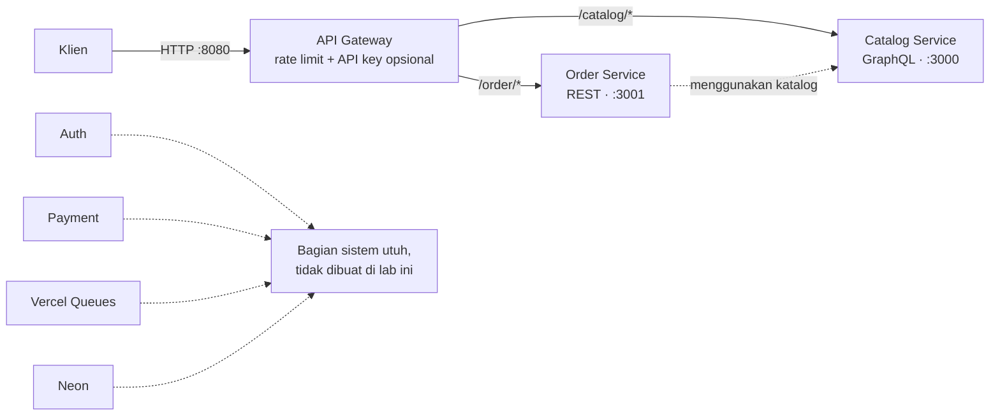

# Lab 08 — API Gateway

Gateway Express pada port `8080` meneruskan `/catalog/*` ke layanan katalog pada port `3000` dan `/order/*` ke layanan order pada port `3001`. Mock service tersedia agar kedua jalur bisa diuji tanpa layanan kelompok.

## Menjalankan

Install dependensi sekali dari folder proyek:

```powershell
npm install
```

Di dua terminal terpisah pada folder proyek, jalankan:

```powershell
npm run start:catalog
```

```powershell
npm run start:order
```

Lalu jalankan gateway dari folder `gateway`:

```powershell
npm install
npm start
```

Uji routing di Postman:

- `GET http://localhost:8080/catalog/products`
- `GET http://localhost:8080/order/orders`

Untuk membuktikan rate limit 20 request per 10 detik, jalankan dari folder proyek:

```powershell
npm run test:rate-limit
```

Skrip mengirim 30 request ke `http://localhost:8080/catalog/`; request setelah batas seharusnya menerima status `429`.
Jika gateway dijalankan dengan API key aktif, set juga `$env:API_KEY` di terminal pengujian agar skrip mengirim header yang benar.

API key bersifat opsional dan hanya melindungi `/catalog`. Tanpa `API_KEY`, pemeriksaan API key tidak aktif. Untuk mengaktifkannya di PowerShell, set environment variable sebelum menjalankan gateway:

```powershell
$env:API_KEY = "ganti-dengan-key-lokal"
npm start
```

Saat aktif, sertakan header `X-API-Key` dengan nilai yang sama pada request katalog; request tanpa key yang benar menerima `401`. `/order` tidak memerlukan API key.

## Catatan dependensi

`npm audit` melaporkan advisory HIGH `GHSA-vfj7-8cjw-p6xm` pada dependency transitif `braces@3.0.3`, yang digunakan melalui `http-proxy-middleware`. `npm audit fix --force` menyarankan downgrade `http-proxy-middleware` ke `0.2.0`, yang tidak kompatibel dengan middleware v3 di lab ini, jadi downgrade tersebut tidak diterapkan.

## Diagram arsitektur



Diagram menunjukkan rancangan sistem kelompok. Mock service yang disertakan di lab ini menggunakan endpoint HTTP/JSON sederhana, bukan implementasi GraphQL atau REST produksi.

## Refleksi

Dengan satu alamat gateway, klien tidak perlu mengetahui lokasi dan port setiap service sehingga routing internal dapat berubah tanpa mengubah konfigurasi klien. Gateway juga menjadi tempat terpusat untuk menerapkan rate limit dan pemeriksaan API key. Jika gateway mati, seluruh akses klien yang melewatinya ikut terhenti meskipun service di belakangnya masih berjalan. Karena itu, gateway perlu dipantau dan disiapkan agar dapat dipulihkan dengan cepat.
